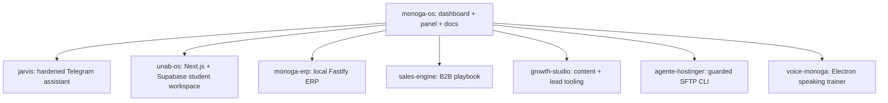

# Monoga OS

The control layer of a one-person software studio: a local dashboard that indexes projects, a lightweight admin panel, and the engineering notes and audits that came out of building an AI-assisted workflow around them. The individual products live in their own repositories.

**Stack:** vanilla HTML/CSS/JS dashboard, Node (ESM) local server bound to `127.0.0.1`, Markdown engineering docs.



## Contents
- `dashboard/` - registry-driven project dashboard. `data/projects.js` is a sanitized sample registry; `server.mjs` adds a local control mode (open folders/terminal, persisted tasks) and reads commands only from the registry.
- `panel/` - self-contained static admin panel (no server needed).
- `docs/engineering/` - dashboard and ERP design reviews. `docs/audits/` - runtime-isolation probe with a fictional fixture.

## Run
```bash
node dashboard/server.mjs     # http://127.0.0.1:4788/
# or open dashboard/index.html / panel/index.html directly (read-only)
```

## Status
🟡 Personal tooling, Spanish UI. Private workspace content (client work, sales research, personal documents, agent configs) is intentionally not included. No automated tests in this repo.

## Folder guide

| Folder | What it holds |
|---|---|
| [dashboard/](dashboard/README.md) | Local project dashboard and control server |
| [dashboard/data/](dashboard/data/README.md) | Sanitized sample project registry |
| [panel/](panel/README.md) | Static admin panel |
| [docs/](docs/README.md) | Engineering reviews and audit evidence |
| [docs/audits/](docs/audits/README.md) | Runtime-isolation audit record |
| [docs/engineering/](docs/engineering/README.md) | Design reviews (advisory, not approved specs) |

---

Built by Monoga · [github.com/Monoga2025](https://github.com/Monoga2025)
